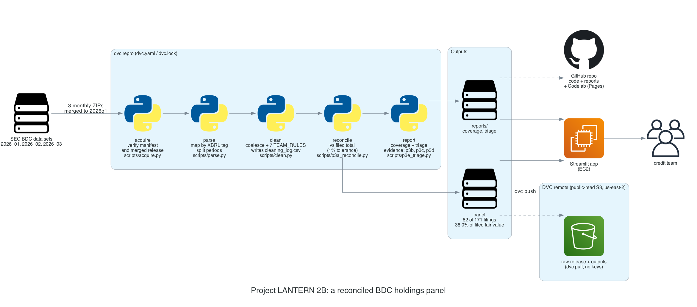
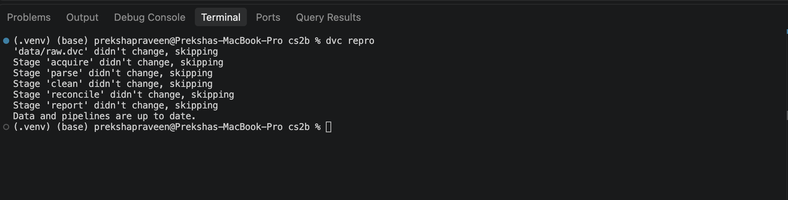
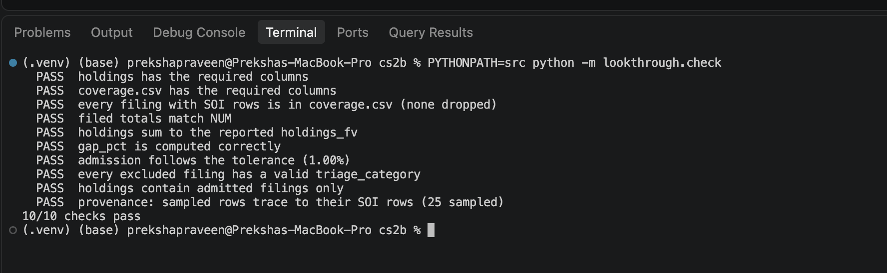
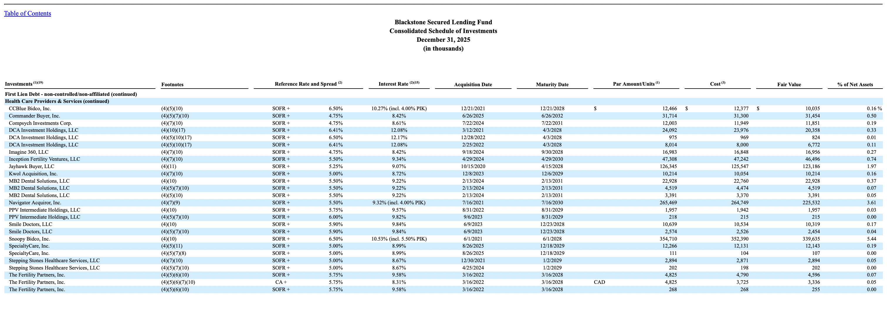
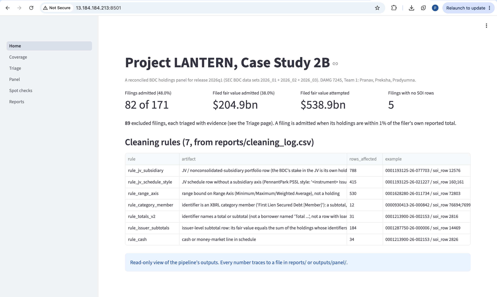
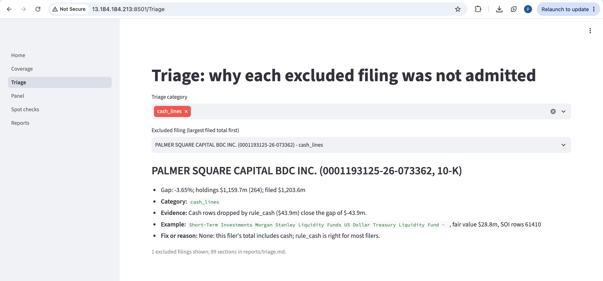

summary: Turn the SEC's raw BDC data sets into one reconciled holdings panel, traceable to every filing and honest about its coverage
id: lantern-case-study-2b
categories: data-engineering
tags: sec, bdc, xbrl, dvc, pandas, reconciliation
status: Published
authors: Team 1 (DAMG 7245, Fall 2026)
feedback link: https://github.com/BigDataIA-Fall-26-Team-1/lantern-case-study-2b

# Project LANTERN, Case Study 2B: a Reconciled BDC Holdings Panel

## Overview
Duration: 5

**Project LANTERN, Case Study 2B (Look-Through), turns the SEC's raw business development company (BDC) data sets into one reconciled holdings panel: every holding of every admitted filing, traceable to its filing and SOI row, adding up to the total the BDC itself reported, and honest about what it covers.**

### The problem

Quanta Capital's credit team invests across BDCs and needs to see through them to the loans they hold: which companies borrow from which BDCs, on what terms and at what marks. Every quarter each BDC publishes every holding in its schedule of investments, and the SEC turns those schedules into flat files. The data exists, but the numbers cannot be trusted as published: adding up a filing's holdings gives the wrong total for most BDCs, because the files also contain subtotals, last year's schedule, joint-venture portfolios, valuation ranges and commitment disclosures.

### What we built

A pipeline for one SEC release, `2026q1` (the SEC's `2026_01`, `2026_02` and `2026_03` files), that:

- downloads the release with a verified manifest and versions it with DVC (Part 0)
- parses the raw tables and maps every column to a canonical field by its XBRL tag (Part 1)
- removes the artifacts that break the totals with seven tested cleaning rules (Parts 2 and 3)
- reconciles each filing to its own reported total, admits those within 1%, and triages every filing it cannot admit (Part 3)
- checks a sample of holdings against the filings by hand (Part 4)
- rebuilds everything with one command, `dvc repro`, and prices the work (Part 5)

### Team

**Big Data and Intelligent Analytics (DAMG 7245), Fall 2026 · Team 1**

| Team member | Parts |
|---|---|
| **Pranav Avinash Waghmare** | Part 0 (setup, acquisition, provenance), Part 5 (pipeline, tests, economics), the app |
| **Pradyumna Reddy Cherla** | Part 1 (raw parsing and schema mapping), Part 3 (reconciliation, coverage, triage) |
| **Preksha Praveen** | Part 2 (cleaning rules), Part 4 (verifying against the filings), the SEC data-set issue draft |

### Links

- **Repository:** [github.com/BigDataIA-Fall-26-Team-1/lantern-case-study-2b](https://github.com/BigDataIA-Fall-26-Team-1/lantern-case-study-2b)
- **Deployed app:** [http://13.184.184.213:8501/](http://13.184.184.213:8501/)
- **Demo video:** TODO

## Architecture
Duration: 3



Every stage reads one folder and writes the next. `dvc.yaml` defines the stages and `dvc.lock` records the hash of every output.

| Stage | Script | Reads | Writes |
|---|---|---|---|
| `acquire` | verifies the release | `data/raw` (tracked by `data/raw.dvc`), `data/manifest.json` | `outputs/acquire/verified.json` |
| `parse` | loads SUB, TAG, NUM and SOI; maps columns by tag; splits periods | `data/raw/2026q1_bdc` | `outputs/work/parse/` |
| `clean` | applies `TEAM_RULES` after coalescing | `outputs/work/parse/` | `outputs/work/clean/`, `reports/cleaning_log.csv` |
| `reconcile` | compares holdings with filed totals; triage evidence | cleaned holdings, NUM | `outputs/panel/holdings.parquet`, `outputs/p3_work/` |
| `report` | writes coverage and triage | reconcile outputs | `reports/coverage.csv`, `coverage.md`, `coverage.json`, `triage.md` |

The tolerance for admission is a DVC parameter (`reconcile.tolerance: 0.01`) and coverage is a DVC metric (`reports/coverage.json`).

## Setup and reproduce
Duration: 10

No AWS credentials are needed: the data is on a public-read S3 remote.

### Prerequisites

- Python 3.11 (3.10 or later works)
- Git

### Reproduce

```bash
git clone https://github.com/BigDataIA-Fall-26-Team-1/lantern-case-study-2b.git
cd lantern-case-study-2b/cs2b
python3.11 -m venv .venv && source .venv/bin/activate
pip install -r requirements.txt
dvc pull
dvc repro
PYTHONPATH=src python -m lookthrough.check
python tests/run_tests.py
```

### What you should see

- `dvc pull` downloads `data/raw/` (43 files, about 1 GB) and every pipeline output, including `outputs/panel/holdings.parquet`, from the public remote.
- `dvc repro` reports every stage as unchanged and skips it, because every output already matches `dvc.lock`.
- The self-check prints `10/10 checks pass` and the tests print `25/25 tests pass`.
- `git status` stays clean.



Negative
: Do not run notebook 02 or `tools/run_notebooks.py`: with `release: "2026q1"` they try to download a ZIP the SEC does not publish (see Part 0).

## Part 0: Acquisition and provenance
Duration: 5

### One release from three monthly files

The SEC publishes 2026 releases monthly, so our assigned quarter, `2026q1`, is three ZIPs. `scripts/merge_release.py` merges them into `data/raw/2026q1_bdc`, so the kit, the notebooks, the self-check and the grader work unchanged.

| Month | Filings | Forms | SOI rows | SOI columns |
|---|---:|---|---:|---:|
| 2026_01 | 2 | 1 10-K/A, 1 10-Q | 2,918 | 47 |
| 2026_02 | 53 | 33 10-K, 20 10-Q | 70,297 | 153 |
| 2026_03 | 123 | 121 10-K, 2 10-K/A | 100,761 | 223 |
| **2026q1** | **178 (176 current)** | | **173,976** | **258** |

Merge rules: concatenate every table by column name (SOI columns differ between months); keep one copy of any adsh; keep the latest filing per CIK and period; add `source_release` and `source_soi_row` so every row still points to the SEC's original monthly file. `scripts/verify_merge.py` compares all 8 tables value by value against the monthly files.

### Provenance and DVC

- `data/manifest.json` records the URL, size, SHA-256 and date of each ZIP; `verify_manifest` returns no mismatches.
- `data/raw` is tracked by DVC (43 files) on S3, with two remotes: `public` (default, read-only over HTTPS, no keys) and `store` (for pushing; keys only in `.dvc/config.local`).

```bash
python -c "import sys; sys.path.insert(0,'src'); from lookthrough import acquire; print(acquire.verify_manifest('data/manifest.json', root='.'))"
```

You should see `[]`.

## Part 1: Raw parsing and schema mapping
Duration: 8

The kit maps each SOI column to a canonical field through its XBRL tag in TAG. On our release that rule alone fails, and Part 1 fixed two problems.

### Fair value and cost under renamed headers

In all three monthly files the preset columns `Investment Owned, Fair Value` and `Investment Owned, Cost` exist but are empty in every row. The values sit under `Initial fair value of Investment` and `Adjusted cost basis`, headers that match no `tlabel` in the release's TAG table. Without a fix, no holding has a fair value. Checked against NUM across 171 filings (`reports/p1_value_column_check.csv`):

| SOI column | Tag | Match with NUM |
|---|---|---|
| Initial fair value of Investment | `InvestmentOwnedAtFairValue` | 99.67% (108,631 of 108,992) |
| Adjusted cost basis | `InvestmentOwnedAtCost` | 99.69% (101,545 of 101,857) |

Fix: an `ALIASES` map in `src/lookthrough/mapping.py`, tested by `test_renamed_soi_value_columns_map_by_alias`. This is also the data-set issue we documented for the SEC (`reports/issue_draft.md`).

### A holding key that keeps joint ventures apart

The kit coalesces rows on (filing, date, identifier). Some BDCs list the same loan once for each joint venture that holds it, so different holdings were merged and only the first value kept. Adding the `Investment Company, Nonconsolidated Subsidiary Axis` and the `Range Axis` to the key changed **63,862 holdings with 458 conflicts into 64,568 holdings with 1 conflict**.

| Measure | Value |
|---|---:|
| Current-period SOI rows | 94,508 |
| Comparative-period rows | 76,622 |
| Current rows without an identifier | 22,039 |
| Filings with SOI rows | 171 (5 have none) |

Full schema: `docs/schema.md`. Three filings compared with their human-readable schedules: `reports/agreement.md`.

## Part 2: Cleaning the extract
Duration: 10

### Survey first, rules second

`scripts/p2a_artifact_survey.py` measures every artifact the brief lists, in the current period, with two examples each (`reports/p2_artifact_survey.csv`). The survey decided which artifacts get a rule:

| Artifact | Found | Decision |
|---|---|---|
| Totals and subtotals | the kit's rule drops 45 holdings, 12 of them borrowers named "Total ..." ($50.3m) | rule `rule_totals_v2` |
| JV portfolio rows on the subsidiary axis | 788 holdings, 10 filings, $4,847.3m | rule `rule_jv_subsidiary` |
| Range-axis rows | 534 holdings, 14 filings | rule `rule_range_axis` |
| Category members as identifiers | 66 holdings; 12 are categories, 54 are borrowers | rule `rule_category_member` (categories only) |
| Comparative rows, restated copies, subtotals with no identifier | 76,622 / 7,881 / 13,597 rows | no rule: handled by period split and coalescing |
| Affiliate and control | 0 holdings carry an affiliation | no rule: the axes sit only on subtotal rows |

### The rules

All rules live in `src/lookthrough/rules.py` as `TEAM_RULES`, with the kit's contract (a drop mask and a one-line artifact), and run in this order:

| # | Rule | Example (adsh / soi_row) | Rows | Without it |
|---|---|---|---:|---|
| 1 | `rule_jv_subsidiary` | 0001193125-26-077703 / 12576 | 788 | 78 filings, 36.1% |
| 2 | `rule_jv_schedule_style` (PennantPark's JV rows with no axis) | 0001193125-26-021227 / 160;161 | 415 | 80 filings, 37.3% |
| 3 | `rule_range_axis` | 0001628280-26-011734 / 72803 | 530 | no change |
| 4 | `rule_category_member` | 0000930413-26-000842 / 76694 | 12 | no change |
| 5 | `rule_totals_v2` | 0001213900-26-002153 / 2816 | 31 | 81 filings, 37.9% |
| 6 | `rule_issuer_subtotals` (Part 3) | 0001287750-26-000006 / 14469 | 184 | 79 filings, 27.0% |
| 7 | `rule_cash` (kit) | 0001213900-26-002153 / 2826 | 34 | 82 filings, 35.6% |

Rules 3 and 4 change no coverage number: they exist because those rows are not holdings, and their tests are the evidence. No rule exists only to force a filing to reconcile.

### Checked against the filings

Rule 2 was confirmed in both PennantPark 10-Qs: the dropped rows sit in the joint venture's listing in the notes, and in PennantPark Investment (0001193125-26-042780) the note's JV total, $1,357,342k, equals the $1.357bn the rule drops.

```bash
python tests/run_tests.py
python scripts/p2b_measure_rules.py
```

Machine-readable log: `reports/cleaning_log.csv`. One paragraph per rule: `docs/cleaning_log.md`.

## Part 3: Reconciliation and coverage
Duration: 10

Each filing's cleaned holdings are compared with its filed total, the undimensioned `InvestmentOwnedAtFairValue` fact in NUM at the period end. A filing is admitted when the gap is within 1%.

### Coverage

| | Filings | Filed fair value |
|---|---:|---:|
| Attempted | 171 | $538.9bn |
| **Admitted** | **82 (48.0%)** | **$204.9bn (38.0%)** |
| In SUB with no SOI rows (reported separately) | 5 | |

### Triage of the 89 excluded filings

| Category | Filings | Filed fair value |
|---|---:|---:|
| other | 46 | $268.6bn |
| custom_tags | 21 | $42.2bn |
| totals_counted | 9 | $15.4bn |
| no_filed_total | 7 | $0.0bn |
| unfunded_commitments | 3 | $5.9bn |
| no_identified_holdings | 2 | $0.7bn |
| cash_lines | 1 | $1.2bn |

Every excluded filing in `reports/triage.md` has its gap, evidence, category, an example and the fix or the reason none is possible.

### Key finding

For 62 of the 80 excluded filings that have holdings and a filed total, the filer's own identifier-level fair-value facts in NUM sum to our parsed holdings within 1%, and in no filing does the median SOI value differ from its NUM value (`scripts/p3d_num_and_subtotals.py`, `reports/p3_gap_evidence3.csv`). Our parse is faithful; most remaining gaps come from what the filers tag (subtotal rows, second schedules, joint ventures), not from parsing.

```bash
PYTHONPATH=src python -m lookthrough.check
```



## Part 4: Verify against the filings
Duration: 8

We sampled holdings from the panel with notebook 07's method (the 5 largest filings plus 5 at random, `random_state=7`, 2 holdings each) and compared each with the filing's human-readable schedule of investments.

| Outcome | Holdings |
|---|---:|
| Fair value and principal match the filing | 18 |
| Not a holding (commitment disclosure) | 2 |
| Value disagreements | 0 |

The 18 matches span three unit conventions (thousands; thousands to one decimal; millions), equity with no principal, an undrawn revolver at a small negative value, and a warrant the filing reports with no value.

### Findings

- **Commitment rows become panel rows.** Ares Capital's soi_row 58925 (Repairify) and North Haven's soi_row 120878 (Granicus) carry only unfunded-commitment facts. They add nothing to any total, so reconciliation is unaffected, but they inflate holding counts.
- **How the SOI writes identifiers.** A trailing number counts repeated lines for an issuer ("Qualus Power Services Corp. 4" is the fourth of four lines); some filers prefix the industry header ("Aerospace & Defense MRO Holdings ...").



EdgarTools was not used: the brief makes it optional with a pinned version, and none was announced.

```bash
python scripts/p4a_spot_check_sample.py
python scripts/p4b_fill_spot_check.py
```

Row by row: `reports/spot_check.csv`. Write-up: `reports/dependency_check.md`.

## Part 5: Pipeline, tests and economics
Duration: 8

### One command

`dvc repro` runs `acquire`, `parse`, `clean`, `reconcile` and `report`. On a fresh clone after `dvc pull` it skips every stage; forced, it reproduces Part 3 exactly (82 of 171, 38.0%, self-check 10/10), on Windows and on Linux (Docker `python:3.11-slim`, `dvc repro -f`).

A lesson from building it: a `.gitignore` written as `outputs/*` with `!` re-includes looked right to Git, but DVC's own Git library treated the folder as ignored, so a plain `dvc pull` silently skipped the panel. Listing each output explicitly, with no wildcard, fixed it, verified on a fresh clone.

### Tests that fail

25 tests pass. Each cleaning rule's test was shown to fail when the rule is broken, then restored (`reports/tests_that_fail.md`).

### Unit economics

| Line | Value |
|---|---|
| Cost per completed task | $0.0000083 of compute per filing (51 s at $0.10/hour, 171 filings) |
| Latency | 51 s for the release, 0.30 s per filing |
| Human time replaced | 82 admitted filings at 2 h each: ×0.5 82 h, ×1 164 h, ×2 328 h |
| Quality | 82 of 171 filings, 38.0% of dollars; 18 of 18 checked holdings match |
| Scale | every quarter since Q4 2022, 16 quarters: about 14 minutes and $0.02 of compute (upper bounds) |

Assumptions and the build-versus-buy paragraph: `reports/economics.md`.

## Results at a glance
Duration: 3

| | Result | Part |
|---|---|---|
| **Release** | `2026q1`: the SEC's `2026_01`, `2026_02` and `2026_03` files merged, 178 filings (176 current), 173,976 SOI rows | 0 |
| **Coverage** | **82 of 171 filings admitted (48.0%), $204.9bn of $538.9bn filed fair value (38.0%)**; 5 filings with no SOI rows reported separately | 3 |
| **Cleaning** | 7 rules, each from an artifact observed in the release, with an example and a test that fails without it; the starter kit's baseline admits 72 filings (24.2%) | 2, 3 |
| **Triage** | all 89 excluded filings categorized with evidence and an example | 3 |
| **Verified by hand** | 20 holdings across 10 filings: 18 match on fair value and principal, 2 are commitment disclosures, 0 value disagreements | 4 |
| **Reproducible** | a fresh clone rebuilds with `dvc pull && dvc repro` (every stage skipped), self-check 10/10, 25 tests pass | 5 |

## The app
Duration: 5

A read-only Streamlit app over the pipeline's outputs, deployed on AWS EC2 in `us-east-2`, the same region as the DVC remote: **[http://13.184.184.213:8501/](http://13.184.184.213:8501/)**.

It never runs the pipeline and needs no AWS keys. It reads the reports that are in Git and the panel pulled from the public DVC remote, so every number it shows traces to a file in the repository.

| Page | Shows | Reads |
|---|---|---|
| Home | headline coverage and the seven cleaning rules | `reports/coverage.json`, `reports/cleaning_log.csv` |
| Coverage | every attempted filing, filtered by admitted, excluded or triage category | `reports/coverage.csv` |
| Triage | one excluded filing's gap, evidence, category and example | `reports/triage.md` |
| Panel | holdings of an admitted filing, searchable, with a link to the filing on EDGAR | `outputs/panel/holdings.parquet` |
| Spot checks | the Part 4 checks against the filings | `reports/spot_check.csv`, `reports/dependency_check.md` |
| Reports | the Markdown deliverables | `reports/*.md`, `docs/*.md` |





### How it is deployed

The server clones the repository with a read-only deploy key, pulls the panel with `dvc pull outputs/panel/holdings.parquet` from the public remote, and runs Streamlit as a `systemd` service, so it restarts on reboot. After a merge, `git pull`, `dvc pull` and a service restart bring it up to date.

## Conclusions
Duration: 3

- **Reconciliation is what makes the panel trustworthy.** The kit's two rules admit 72 filings (24.2% of dollars); seven evidenced rules admit 82 (38.0%), and every exclusion is explained rather than forced.
- **The parse is faithful.** Values agree with the filings (18 of 18 checked) and, for most excluded filings, with the filers' own XBRL facts. The remaining gaps come from how filers tag their schedules.
- **Treat every source as a claim to check.** The SEC's own data set hides fair value under headers missing from its TAG table (`reports/issue_draft.md`), and the starter kit's totals rule drops real borrowers. Both were found by checking, not assumed.
- **Limits.** One release, mostly 10-Ks; 46 excluded filings ($268.6bn) are categorized `other` with evidence but no single cause; the hand check covers 20 holdings.

### Links

- Repository: [github.com/BigDataIA-Fall-26-Team-1/lantern-case-study-2b](https://github.com/BigDataIA-Fall-26-Team-1/lantern-case-study-2b)
- Deployed app: [http://13.184.184.213:8501/](http://13.184.184.213:8501/)
- Demo video: TODO
